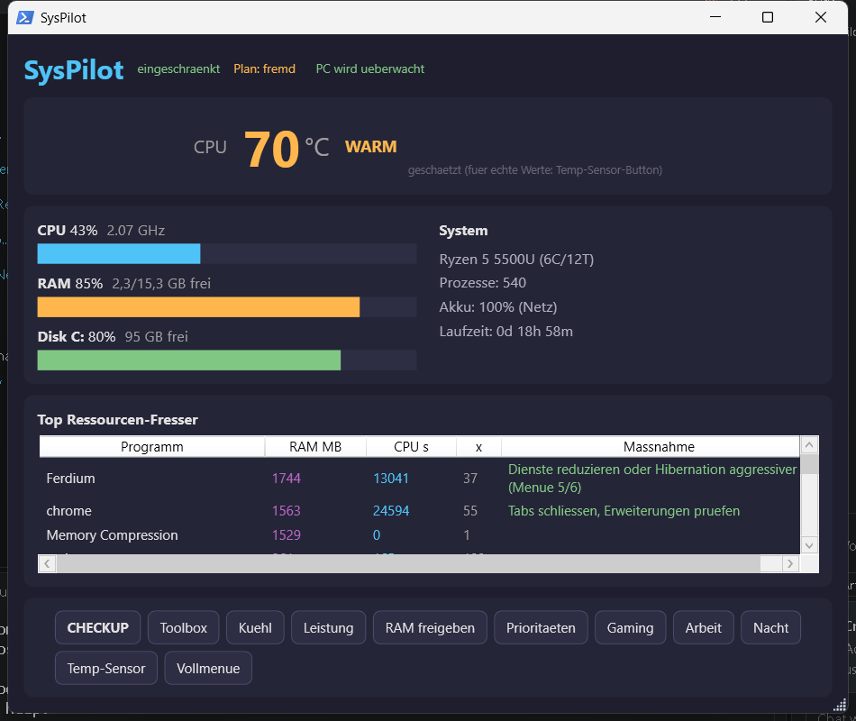
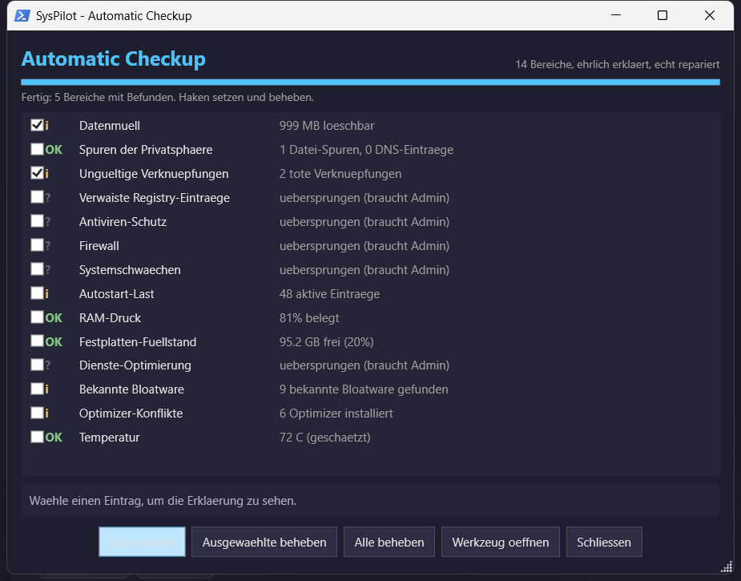
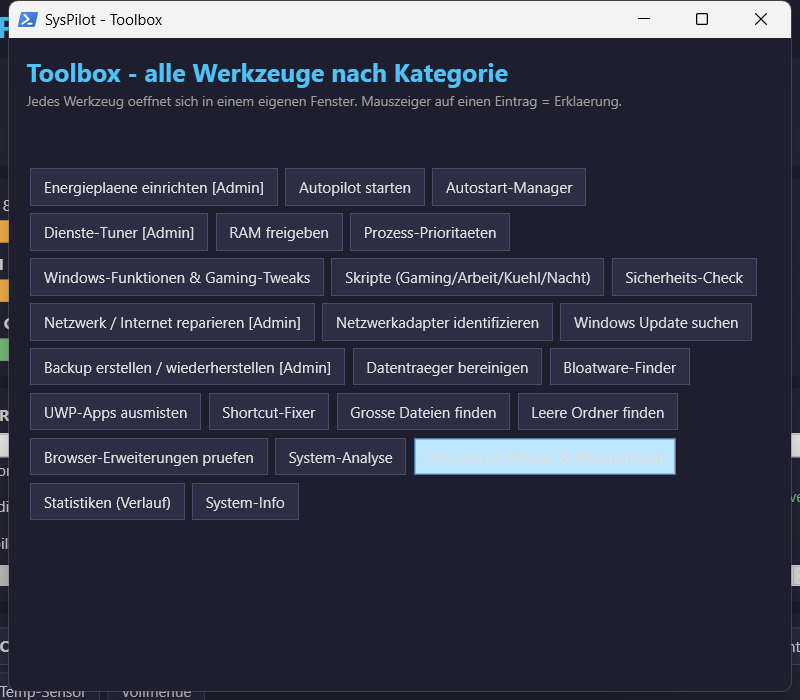

# SysPilot — Dein intelligenter PC-Autopilot

Kostenlose, offene Alternative zu Camomile Pro — aber cleverer und mit mehr Funktionen.
Reines PowerShell, keine Installation, keine Telemetrie, alles bleibt auf deinem PC.

<p align="center">
  
  <br>
  <sub>Live-Dashboard: CPU-Temperatur (groß), CPU/RAM/Disk-Balken, Top-Ressourcen-Fresser mit Maßnahmen, Ein-Klick-Aktionen</sub>
</p>

<p align="center">
  
  <br>
  <sub>Automatic Checkup: 14 Bereiche, ehrlich erklärt, echt repariert — Fixes einzeln abwählbar</sub>
  <br><br>
  
  <br>
  <sub>Toolbox: 24 Werkzeuge nach Kategorie, jedes mit verständlicher Erklärung</sub>
</p>

---

## 💛 Spenden / Donate

<p align="center">
  
</p>

**🇩🇪** Meine Software ist Hobby & Donationware. Kostenlos, Open Source, ohne
Werbung. Wenn sie dir gefällt: spende, was du willst — für Pizza, Döner,
Kaffee und gelegentlich VS Code + Copilot. Du musst nicht spenden — aber wenn
du mir eine Freude machen willst, freue ich mich. 💛

**🇬🇧** My software is hobby & donationware. Free, open source, no ads. If you
like it: donate what you want — for pizza, döner, coffee, and occasionally
VS Code + Copilot. You don't have to donate — but if you want to make my day,
I'd appreciate it. 💛

<p align="center">
  <a href="https://buy.stripe.com/00waEYchZ9wmcHl2Zv2Ji02">
    
  </a>
  <br>
  
</p>

<p align="center">
  <a href="DONATE.md">Mehr erfahren / Learn more</a>
</p>

---

## Start

Rechtsklick auf `SysPilot.ps1` → **Mit PowerShell ausführen**.
Keine Start-Frage — Admin-Rechte holst du dir bei Bedarf über Menü **[16]**
oder den **„Als Admin starten"-Button** in der GUI.
Ohne Admin laufen Analyse, Autostart, Prioritäten und Skripte trotzdem.
(Wer die alte Start-Abfrage will: `config.json` → `Start.AskForAdmin = true`.
Wer SysPilot immer erhöht will: Einstellungen → „Immer als Administrator starten".)

**Steuerung im Text-Menü:**
- **Pfeiltasten ↑ ↓** = Auswahl bewegen
- **Enter** = ausführen
- **Esc** = beenden (SysPilot läuft im Hintergrund weiter — Tray-Symbol)
- (Maus geht in der Konsole leider nicht — dafür ist die GUI da, Menü **20**)

Oder im Terminal:

```powershell
powershell -NoProfile -ExecutionPolicy Bypass -File C:\Users\haber\SysPilot\SysPilot.ps1
```

## Was SysPilot besser macht als Camomile

| Funktion | Camomile Free | Camomile Pro (~52 €/Jahr) | SysPilot |
|---|---|---|---|
| CPU-Kühlung per Energieplan | ✅ manuell | ✅ | ✅ |
| **Autopilot** (automatische Umschaltung) | ❌ | ✅ | ✅ |
| Autopilot erkennt **Spiele** und schaltet sofort um | ❌ | ❌ | ✅ |
| **Vordergrund-App** bekommt automatisch mehr CPU | ❌ | ❌ | ✅ |
| Wichtige Programme (VS Code, Compiler) bevorzugen | ❌ | ❌ | ✅ |
| Ballast-Prozesse bremsen (Updater, Cloud-Sync) | ❌ | ❌ | ✅ |
| Bloatware-Deinstallations-Manager | ❌ | ❌ | ✅ |
| Autostart-Manager mit Empfehlungen | ❌ | ❌ | ✅ |
| Dienste-Optimierung mit Backup | ❌ | ❌ | ✅ |
| **Ein-Klick-Auto-Optimierung** (Dienste+Features+Tweaks) | ❌ | ❌ | ✅ |
| Datenträger-Bereinigung | ❌ | ❌ | ✅ |
| **RAM freigeben** (manuell + automatisch im Autopilot) | ❌ | ❌ | ✅ |
| Gaming-Tweaks (Game Mode, HAGS, Telemetrie) | ❌ | ❌ | ✅ |
| Optik bleibt **hübsch** (kein Augenkrebs für 2 %) | ❌ | ❌ | ✅ |
| Zeigt dir **warum** es umschaltet (Log) | ❌ | teilweise | ✅ |

## Wie die Kühlung funktioniert

Dein Ryzen 5 5500U heizt sich vor allem durch den **Boost-Takt** (bis 4 GHz) auf.
Der Plan **„SysPilot Kühl & Leise"** deaktiviert den Boost — die CPU bleibt auf
2,1 GHz Basistakt. Das kostet bei Alltagsaufgaben kaum spürbar Leistung, senkt
aber Temperatur und Lüfterlärm deutlich (genau wie Camomile, das intern nichts
anderes tut: `PowerDuplicateScheme` + Energieplan-Werte).

Der Plan **„SysPilot Leistung"** gibt alles frei: Boost aggressiv, 100 % Takt —
für Gaming, Kompilieren, VS Code.

## Der Autopilot (Menüpunkt 3)

- Last hoch (≥ 55 %, anhaltend) → **Leistung**
- Last niedrig (≤ 22 %, anhaltend) → **Kühl**
- **Spiel läuft** (Liste in config.json) → sofort **Leistung**
- **Akku** → bevorzugt Kühl (schnelleres Zurückschalten)
- **Auto-RAM**: bei ≥ 85 % Speicherbelegung automatisch Working Sets verkleinern
  + Standby-Cache leeren (als Admin) — konfigurierbar in config.json
- Tasten im Autopilot: `C` = Kühl, `P` = Leistung, `A` = Auto, `Q` = Ende
- Wendet bei jedem Zyklus die Prozess-Prioritäten an

Menüpunkt **4** richtet ein, dass der Autopilot bei jeder Anmeldung
automatisch (versteckt, im Hintergrund) startet.

## Prioritäten (config.json)

- **ImportantProcesses** → `AboveNormal`: VS Code, Compiler (cl, link, msbuild,
  node, python, cargo, go, dotnet …), Docker, Ghidra …
- **GameProcesses** → `High`: hier deine Spiele eintragen (Menü 11)!
  Beispiel: `"cyberpunk2077"`, `"eldenring"` — Prozessname ohne `.exe`.
- **JunkProcesses** → `BelowNormal`: OneDrive, TeraBox, Updater, Honeygain …
- **BoostForegroundApp**: das Fenster, in dem du gerade arbeitest, bekommt
  automatisch `AboveNormal`.

## Wichtig: Diese Apps verkaufen deine Internet-Verbindung!

**Honeygain**, **EarnApp** und **Bright VPN** (Brightdata/Luminati) nutzen deinen
PC als Proxy-Ausgangsknoten — fremder Traffic läuft über deine IP.
Empfehlung: über Menü **6** deinstallieren.

Außerdem gefunden: **7 PC-Optimizer gleichzeitig** (Advanced SystemCare, Wise Care 365,
Glary Utilities, Game Fire, Razer Cortex, SmartRAM, ReduceMemory). Die bremsen sich
gegenseitig — SysPilot ersetzt sie alle. Empfehlung: alle deinstallieren.

## Auto-Optimierung (Menüpunkt 8)

Ein Klick, alles erledigt — mit Backup vorher:
1. Backup (Dienste, Registry, Energiepläne)
2. Alle geprüften Dienste-Empfehlungen anwenden
3. Sicher unnötige Windows-Features aus (Fax, XPS, WorkFolders)
4. Game Mode an, Werbung/Tipps aus, **Optik bleibt hübsch**
5. Prozess-Prioritäten anwenden

Rückgängig: Menü **15** (Backup wiederherstellen).

## Optik: hübsch statt hässlich

SysPilot stellt die Optik **nicht** auf „Leistung" (graue Blöcke, keine
Animationen). Ehrlich gerechnet: Animationen laufen auf deiner Radeon-GPU
und kosten **unter 1 %** — das Abschalten ist Augenkrebs für nichts.
Menü **10 → 5** hält Schriftglättung (ClearType), Animationen und Transparenz
aktiv. Wer es trotzdem hässlich-schnell will: Menü **10 → 6**.

## RAM freigeben (Menüpunkt 12 + automatisch)

Ehrlich statt Cleaner-Magie: Working Sets aller Prozesse verkleinern +
Standby-Cache leeren (als Admin), mit Vorher/Nachher-Messung.
Windows füllt freien RAM als Cache wieder auf — das ist normal.
**Dauerhaft** mehr RAM gibt es nur durch: Programme schließen,
Autostart reduzieren (5), Bloatware deinstallieren (6/7).

## Ressourcen-Fresser & Maßnahmen (Menüpunkt 17)

Findet RAM- und CPU-Fresser — auch Apps, die nur manchmal laufen — und
sagt dir **warum** sie Ressourcen ziehen und **was du tun kannst**.
Beispiele: Ferdium (24 Dienste = 2–3 GB), Honeygain/EarnApp/Bright VPN
(Bandbreiten-Sharing → deinstallieren), SearchIndexer/SysMain (Dienste),
Launcher (Autostart aus). Schwellwerte in `config.json` → `Hogs`.

## Statistiken (Menüpunkt 18)

Der Autopilot sammelt jede Minute einen Datensatz (CPU, RAM, Prozesse,
Top-Verbraucher, Energieplan) in `logs\stats.csv`. Menü 18 zeigt
Durchschnitt/Maximum, häufigste RAM-Verbraucher und die letzten Einträge.

## Skripte (Menüpunkt 19) — vorgefertigt & anpassbar, ohne KI

Fertige Abläufe, die du mit einem Tastendruck startest und in Notepad
anpassen kannst (`E<Nr>` = bearbeiten, `N` = neu):

| Skript | Was es tut |
|---|---|
| **01-Gaming-Modus** | Leistung-Plan, Hintergrund auf IDLE, RAM frei, Game Mode |
| **02-Arbeits-Modus** | Kühl-Plan, Dev-Tools (VS Code, Compiler) bevorzugen |
| **03-Kühl-Modus** | Kühl-Plan, Ballast-Apps schließen, RAM frei |
| **04-Aufräumen** | Temp leeren, RAM frei, Kurz-Analyse |
| **05-Nacht-Modus** | Alles Unnötige schließen, maximal kühl & leise |

Eigene Skripte: `N` im Skript-Menü → Vorlage öffnet sich in Notepad.
Alle SysPilot-Funktionen stehen darin zur Verfügung.

## Grafische Oberfläche (Menüpunkt 20)

Schlanke **WPF-GUI** (Windows-eigen, kein Electron) — ~80 MB RAM, dunkel:

- **CPU-Temperatur groß** oben (grün OK / orange WARM / rot HEISS)
- **Live-Balken**: CPU (mit GHz-Takt), RAM, Disk C:
- **System-Info**: CPU, Prozesszahl, Akku, Laufzeit, aktiver Energieplan
- **Top Ressourcen-Fresser** mit Maßnahmen-Empfehlung
- **Buttons**: Kühl / Leistung / RAM freigeben / Prioritäten / Gaming / Arbeit / Nacht / Vollmenü

Start: Menü **20** oder direkt `SysPilot-GUI.ps1`.
Aktualisiert alle 2 s (Metriken), Top-Liste alle 10 s (flackert nicht).

**Steuerung — Maus ODER Tastatur:**
- **Maus**: Buttons klicken
- **Tastatur**: `←` `→` `↑` `↓` durch die Buttons, `Enter` = ausführen, `Esc` = schließen (in Tray)
- Bei jeder Aktion öffnet sich das Fenster **automatisch** in den Vordergrund
- Fenster schließen → läuft im Tray weiter (Rechtsklick → Beenden)

**Echte Temperatur statt Schätzung:** Klicke im GUI auf den Button
**„Temp-Sensor"** — SysPilot erklärt dir warum und installiert
[LibreHardwareMonitor](https://github.com/LibreHardwareMonitor/LibreHardwareMonitor)
**vollautomatisch** (kostenlos, Open Source, ~5 MB, portable, keine Telemetrie)
und startet es. Danach liest SysPilot den echten CPU-Sensor — auch für den
Hitzeschutz (Notaus bei 95 °C). Ohne es schätzt SysPilot aus Last + Takt
(als „geschätzt" markiert).

## Autopilot: App-Erkennung + Temperatur-Notbremse

Der Autopilot (Menü 3) wählt den Plan jetzt **nach dem, was du tust**:

| Erkannt | Plan | Warum |
|---|---|---|
| **Spiel** läuft | Leistung | volle Power |
| **VS Code / Compiler** läuft | Leistung | Entwicklung braucht Takt |
| **Nur Browser** läuft | Kühl | Surfen braucht keinen Boost |
| **CPU ≥ 80 °C** | Kühl | **Hitze-Notbremse** (hat Vorrang vor allem) |
| sonst, Last hoch | Leistung | anhaltende Last |
| sonst, Last niedrig | Kühl | ruhig / Akku |

Reihenfolge: **Hitze > App > Last**. Schwellwerte in `config.json` →
`Autopilot.TempHotC` (80), `TempWarmC` (70), App-Listen unter
`GameProcesses` / `ImportantProcesses` / `BrowserProcesses`.

## Browser-Erweiterungen (Menüpunkt 21)

Findet **alle** Erweiterungen in Chrome, Edge, Brave, Opera, Firefox und
sortiert sie nach Kategorie: KI/Summarizer, Coupon/Cashback, Cache-Cleaner,
AdBlock, VPN, Passwort-Manager, Tab-Manager, Preisvergleich u. v. m.

**Warnt bei Duplikaten**, die sich beißen:
- **KI/Summarizer**: 1 reicht (nicht 28 Perplexity-/ChatGPT-/Gemini-Helfer)
- **Coupon/Cashback**: 1 reicht (Honey ODER Rakuten, nicht beide)
- **Cache Cleaner**: **gar keiner** — SysPilot macht das besser (Menü 11)
- **AdBlock**: 1 reicht (uBlock Origin genügt)

`<Nr>` öffnet die Extension-Seite im jeweiligen Browser zum Deaktivieren.

## Hintergrund-Betrieb (Tray) & Hitzeschutz

**Tray statt Vordergrund:** Das GUI-Fenster kannst du schließen — SysPilot
läuft dann **im Hintergrund weiter** und sitzt in den **ausgeblendeten
Symbolen** (Pfeil nach oben in der Taskleiste). Es drängelt sich **nicht**
in den Vordergrund — Spiele und Programme haben immer Vorrang.
Auch **"Beenden" im Text-Menü** beendet SysPilot nicht wirklich: Die GUI
läuft im Tray weiter (abschaltbar: Einstellungen → "Beim Beenden im
Hintergrund weiterlaufen").

**Komfort-Details:**

- **Nur eine GUI:** Doppelstarts werden abgefangen — statt einer zweiten
  Instanz kommt das vorhandene Fenster nach vorne.
- **Kein Konsolen-Fenster:** Die GUI versteckt ihr PowerShell-Fenster
  selbst — kein Fenster-Chaos, nichts wirkt verdächtig.
- **"Als Admin starten"-Button** im GUI-Kopf (nur sichtbar, wenn nötig).
- **Immer als Administrator:** Einstellungen → "Immer als Administrator
  starten" setzt zusätzlich das "Als Administrator ausführen"-Flag auf
  allen SysPilot-Verknüpfungen (wie Rechtsklick → Eigenschaften →
  Kompatibilität, nur automatisch).
- **Installer-Häkchen:** Bei der Installation wählst du per Häkchen
  (standardmäßig an): Autopilot bei Anmeldung, Smart Boost (RAM automatisch
  freigeben), Immer als Administrator.

- **Doppelklick** aufs Symbol → Fenster zeigen
- **Rechtsklick** → Menü: Anzeigen / Kühl / Leistung / RAM freigeben / **Beenden**

**Hitzeschutz (vollautomatisch, einstellbar):**

| Temperatur | Aktion |
|---|---|
| ≥ 70 °C | WARM (orange) — beobachten |
| ≥ 80 °C | HEISS → Plan auf **Kühl** + unwichtige Prozesse auf IDLE drosseln |
| ≥ 95 °C | **KRITISCH → Ruhezustand** (30 s Countdown, abbrechen möglich) |

Ruhezustand statt Herunterfahren: alles bleibt gespeichert, PC ist sofort
wieder da. Grenzen in `config.json` → `Autopilot.TempWarmC/HotC/CriticalC`,
Aktion `TempCriticalAction` (`Hibernate` oder `Shutdown`).

**Was ist gefährlich?** Dein Ryzen 5 5500U ist bis **105 °C** spezifiziert
und drosselt sich ab ~95 °C selbst. Dauerhaft über 90 °C altert CPU und
Lötpunkte schneller. SysPilot greift ab 80 °C ein — früh genug, bevor es
kritisch wird.

## Bloatware-Finder (Menüpunkt 6) — Crapfixer-artig

Findet **bekannte Bloatware** (recherchiert aus Win11Debloat, winutil,
Malwarebytes PUP-Listen) und markiert sie:

- **UWP/Store-Apps**: Facebook, TikTok, Instagram, Candy Crush, Spotify,
  Netflix, Disney+, Clipchamp, Teams, Solitaire, Bing News/Weather,
  Phone Link, Copilot, Widgets, Quick Assist u. v. m. (21 bei dir gefunden)
- **Desktop**: Honeygain, EarnApp, Bright VPN (Bandbreiten-Sharing!),
  Optimizer-Duplikate (Camomile, Advanced SystemCare, Wise, Glary,
  Game Fire, Driver Booster, iTop), Cloud/VPN-Duplikate, Hersteller-Bloat
  (HP, Dell, Lenovo, Acer, ASUS, McAfee, Norton, WildTangent …)

**Pfeiltasten** durch die Liste, **Enter** = deinstallieren (mit Rückfrage),
**Esc** = zurück. Nach der Deinstallation werden **Reste automatisch
entfernt** (AppData, ProgramData, Program Files).

## Werbung (Menüpunkt 10)

Zwei unabhängige Schalter (beide mit Pfeiltasten, Enter = umschalten):

- **Microsoft-Eigenwerbung**: automatisch installierte Werbe-Apps,
  Vorschläge, Tipps, Startmenü-Ads. Aus = weniger Crap.
- **Personalisierte Werbung**: Werbe-ID/Tracking für Apps. Manche finden
  personalisierte Werbung nützlicher als generische — deshalb getrennt
  wählbar. Aus = weniger Tracking.

## Einstellungen (Menüpunkt 14)

- **Sprache**: Deutsch / English (umschaltbar)
- **Temperatureinheit**: Celsius / Fahrenheit (GUI zeigt °C oder °F)
- **Konfiguration**: Programme, Spiele, Ballast

## Netzwerk / Internet reparieren (Menüpunkt 22)

Alle 14 Reparaturen aus **Complete Internet Repair** (Open Source, recherchiert):

1. TCP/IP zurücksetzen (IPv4/IPv6)
2. Winsock reparieren (Katalog zurücksetzen)
3. IP-Adresse erneuern (DHCP release/renew)
4. DNS-Cache leeren (flushdns/registerdns)
5. ARP-Cache leeren
6. Windows Update Verlauf löschen
7. Windows Update reparieren (Dienste + DLLs)
8. SSL / HTTPS / Kryptografie reparieren
9. Proxy-Einstellungen zurücksetzen
10. Windows-Firewall zurücksetzen
11. Hosts-Datei wiederherstellen (mit Backup)
12. WINS-Client-Registrierung erneuern
13. Netzwerk-Computer sichtbar machen (Explorer)

Pfeiltasten, Enter = reparieren, „ALLE" = alle auf einmal. Manche brauchen
einen Neustart (markiert).

## Netzwerkadapter identifizieren (Menüpunkt 23)

Zeigt alle Netzwerkadapter und identifiziert das zugehörige Programm:
- **vgate0** → OPPO Connect (Handy-Verbindung) — falls du kein OPPO hast: deinstallieren
- **TAP-Windows** → OpenVPN / generischer VPN-Treiber
- **vEthernet** → Hyper-V / WSL2 / Docker
- **Bluetooth** → Bluetooth-Netzwerk (PAN)
- Unbekannte → Google-Suche anbieten

Bei bekannten Adaptern mit „deinstallieren"-Hinweis: Enter → SysPilot bietet
die Deinstallation des zugehörigen Programms an.

## Automatic Checkup (Menüpunkt 24 / GUI-Button CHECKUP)

Der Komplett-Check für deinen PC — **ehrlich**: keine erfundenen „Probleme" als
Verkaufsdruck, sondern 15 reale Bereiche mit ausführlicher Erklärung und echter
Reparatur. Jeder Bereich sagt dir **genau, was gemacht wird — und was nicht.**

| Bereich | Was SysPilot prüft | Was der Fix macht (und was NICHT) |
|---|---|---|
| Datenmüll | Temp, Update-Cache, Caches | Löscht nur temporaere Dateien — deine Dokumente/Bilder bleiben |
| Spuren der Privatsphäre | Zuletzt geöffnete Dateien, DNS-Verlauf, Sprunglisten | Löscht nur lokale Verlaufs-Listen. **Schaltet KEINE personalisierte Werbung, Standort oder Telemetrie ab** (das sind separate Schalter, die du selbst steuerst) |
| Tote Verknüpfungen | Desktop/Startmenü-Links auf gelöschte Programme | Löscht nur tote Links — keine funktionierenden Verknüpfungen |
| Tote Registry-Verweise | Verweise auf gelöschte Dateien (Autostart, Deinstallation, App Paths) | Entfernt tote Verweise, vorher Backup (.reg). **Ändert nichts an Netzwerk, Freigaben oder installierten Programmen** |
| Virenschutz-Status | Defender aktiv? Echtzeitschutz? Signaturen aktuell? | Schaltet Echtzeitschutz ein + aktualisiert Signaturen. **Deinstalliert kein Antivirus** |
| Firewall-Status | Alle Profile (Privat/Öffentlich/Domain) aktiv? | Schaltet abgeschaltete Profile ein. **Ändert keine Regeln, blockiert keine Programme** |
| System-Härtung | SMBv1, PowerShell v2, UAC, ausstehender Neustart | **SMBv1 nur nach Rückfrage** (alte NAS/Fritz!Box brauchen es evtl. noch!). **Netzwerkerkennung, Dateifreigabe und Samba bleiben an** |
| Autostart-Last | Mehr als 15 aktive Einträge? | Ändert hier nichts — öffnet den Autostart-Manager (deaktiviert, löscht nicht) |
| RAM-Druck | Ab 85% wird ausgelagert | Leert Arbeitsseiten + Standby-Cache — laufende Programme bleiben |
| Festplatten-Füllstand | Unter 15% frei bremst Windows | Löscht nur temporaere Dateien (wie „Datenmüll") |
| Dienste-Optimierung | Ausstehende geprüfte Empfehlungen | Stellt Dienste auf „Manuell". **Enthält KEINE Dienste für Netzwerkerkennung, Dateifreigabe, Samba oder Standort** — die bleiben an |
| Bloatware-Radar | Bekannte Werbe-Apps | Ändert hier nichts — öffnet den Bloatware-Finder (jede App einzeln, erst nach Bestätigung) |
| Optimizer-Duplikate | Mehrere Optimizer bremsen sich | Ändert hier nichts — öffnet den Optimizer-Manager |
| Netzwerk-Check | Internet, DNS, Proxy in Ordnung? | Ändert hier nichts — öffnet NETREPAIR (jede Reparatur einzeln bestätigt). **Schaltet nicht Netzwerkerkennung/Freigabe/Samba ab** |
| Temperatur | Ab 80°C | Aktiviert den Kühl-Plan (CPU-Boost aus) — jederzeit über GUI umkehrbar |

Ablauf: **Scan mit Fortschrittsanzeige → Ergebnis mit Ampel ([OK]/[i]/[!]) →
„Alle beheben" oder einzeln ansehen (mit Erklärung) und auswählen.**
Was deine Entscheidung braucht (Autostart, Bloatware), öffnet direkt das passende Werkzeug.

In der GUI: eigener **CHECKUP**-Button mit Fenster, Häkchen zum Abwählen,
Hintergrund-Scan (Oberfläche bleibt flüssig) und Erklärungstext pro Eintrag.

### Checkup-Zeitplan (automatisch laufen lassen)

Im Checkup-Menü (oder Toolbox → „Checkup-Zeitplan") stellst du ein, **wann der
Checkup von allein läuft**:

- **Wie oft:** täglich oder an einem Wochentag (Mo–So)
- **Uhrzeit:** z. B. 03:00 (nachts) oder 18:30
- **Automatisch beheben:** an (repariert sofort) oder aus (nur prüfen)

Läuft als geplante Aufgabe „SysPilot Checkup" im Hintergrund — du musst nicht
dran denken.

## Toolbox (Menüpunkt 25 / GUI-Button Toolbox)

Alle 29 Werkzeuge in 4 Kategorien, jedes mit ehrlicher Erklärung:

- **System optimieren**: **Vollautomatik** (Auto-Optimierung), Energiepläne,
  Autopilot, **Autopilot bei Anmeldung**, **Smart Boost** (RAM automatisch
  freigeben), **Checkup-Zeitplan**, **SysPilot Guardian**, Autostart-Manager,
  Dienste-Tuner, RAM freigeben, Prioritäten, Gaming-Tweaks, Skripte
- **Sicherheit & Reparatur**: Sicherheits-Check, Netzwerk-Reparatur (14 Reparaturen),
  Adapter identifizieren, Windows Update, Backup
- **System bereinigen**: Datenträger, Bloatware, UWP-Apps, **Shortcut-Fixer**,
  **Große Dateien finden**, **Leere Ordner finden**, Browser-Erweiterungen
- **Analyse & Info**: System-Analyse, Ressourcen-Fresser, Statistiken, System-Info

In der GUI öffnet die Toolbox ein eigenes Fenster mit Kategorien — jeder Klick
startet das Werkzeug in einem eigenen Fenster (mit Admin-Rechten, falls nötig).

## SysPilot Guardian (läuft SysPilot nicht mehr?)

Der **Guardian** (Toolbox → „SysPilot Guardian") wacht über SysPilot: Eine
geplante Aufgabe prüft **alle 2 Minuten**, ob die GUI läuft — und startet sie
automatisch neu, falls nicht. Du wählst den Start-Modus:

- **GUI offen (Standard):** Fenster wird gezeigt
- **Nur im Tray (versteckt):** startet im Hintergrund, nur das Tray-Symbol

So läuft SysPilot immer weiter, ohne dass du dich kümmern musst.

## Sicherheit

- **Backup** vor jeder Dienste-Änderung (Menü 12 erstellt manuell eins)
- Energiepläne, Dienste, Autostart und Registry werden exportiert nach `backup\`
- Nichts wird gelöscht, was nicht wiederherstellbar ist
- Autostart-Einträge werden **deaktiviert**, nicht gelöscht
- Alle Aktionen werden in `logs\` protokolliert

## Dateien

```
SysPilot.ps1        Hauptprogramm (Menü, 25 Einträge)
SysPilot-GUI.ps1    Grafische Oberfläche (Dashboard, Checkup, Toolbox, Tray)
config.json         Alle Regeln und Empfehlungen
modules\            PowerPlans, Priorities, Startup, Bloatware, Services,
                    Features, Cleanup, Memory, Insights, Extensions, Scripts,
                    Temperature, Localization, AutoOptimize, NetworkRepair,
                    NetworkAdapters, Checkup, Toolbox, Common
backup\             Automatische Sicherungen
logs\               Protokoll aller Aktionen
```
